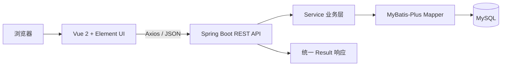
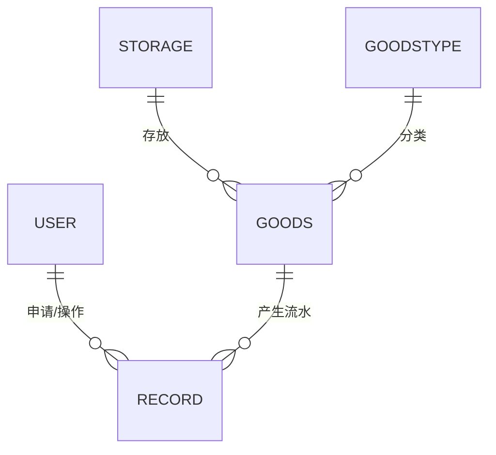

# 物资管理系统（MaterialManagement）

一个基于 **Spring Boot + Vue 2 + Element UI + MyBatis-Plus + MySQL** 构建的前后端分离物资管理系统。

项目围绕“物品、仓库、分类、用户、出入库流水”几个核心对象展开，提供登录鉴权、动态菜单、基础资料维护、分页查询、出入库登记和流水查询等功能，适合用于课程设计、毕业设计、Java 全栈学习或小型内部物资管理场景。

## 项目简介

在日常物资管理中，物品通常需要同时维护所属仓库、分类、当前库存和流转记录。本项目将这些信息拆分到独立的数据对象中，并通过统一的 Web 管理端完成维护。

系统包含两个主要角色：

- **管理员**：维护用户、物品、仓库、分类，并执行入库、出库操作。
- **普通用户**：查看物品信息和与自身相关的出入库记录。

后端采用 REST 风格接口，前端通过 Axios 调用后端服务；登录后根据用户角色加载菜单，再由菜单数据动态生成前端路由。

## 主要功能

### 登录与动态导航

- 使用账号和密码登录。
- 登录成功后返回当前用户信息及其可访问菜单。
- 根据菜单表动态注册前端路由，不同角色看到不同的功能入口。
- 首页展示当前登录用户的账号、电话、角色和账号状态。

### 物品管理

- 新增、编辑、删除物品。
- 按物品名称、仓库和分类组合筛选。
- 分页展示物品编号、名称、仓库、分类、数量和备注。
- 维护物品所属仓库、分类和当前库存数量。

### 仓库与分类管理

- 仓库信息的新增、修改、删除和分页查询。
- 物品分类的新增、修改、删除和分页查询。
- 为物品管理提供仓库、分类下拉选项。

### 出入库与流水记录

- 管理员选择物品后登记入库或出库。
- 每次操作记录物品、申请用户、操作人、数量、时间和备注。
- 入库时增加物品库存，出库时扣减物品库存。
- 流水列表支持按物品名称、仓库和分类筛选。
- 普通用户查询流水时，后端按当前用户 ID 限制可见记录范围。

### 用户管理

- 新增、编辑、删除用户。
- 按姓名和角色筛选用户。
- 维护账号、姓名、联系电话、角色和账号状态。
- 登录时根据角色加载对应菜单。

## 技术栈

| 层级 | 技术 |
| --- | --- |
| 前端框架 | Vue 2.6、Vue Router 3、Vuex 3 |
| UI 组件 | Element UI 2 |
| 请求工具 | Axios |
| 前端构建 | Vue CLI 5 |
| 后端框架 | Spring Boot 2.7.6 |
| 数据访问 | MyBatis-Plus 3.5.2 |
| 数据库 | MySQL 8 |
| 开发语言 | Java 8、JavaScript |
| 构建工具 | Maven、npm |

## 系统架构



前端负责页面展示、表单校验、菜单和路由渲染；后端负责登录校验、分页查询、库存更新、流水写入和数据关联查询。

## 核心业务流程

1. 用户提交账号和密码。
2. 后端校验用户，并按照 `user.role` 从菜单表加载可访问菜单。
3. 前端保存用户信息，并根据菜单数据动态注册路由。
4. 管理员维护物品、仓库、分类及用户信息。
5. 管理员对指定物品登记入库或出库：
   - `action = 1`：入库，库存增加。
   - `action = 2`：出库，记录数量转为负数，库存减少。
6. 系统同步新增一条流水记录，记录申请人、操作人、物品、数量、时间和备注。
7. 用户可在流水页面按物品、仓库和分类检索历史记录。

## 数据模型

| 数据对象 | 主要字段 | 说明 |
| --- | --- | --- |
| `user` | `account`、`name`、`password`、`phone`、`role`、`isValid` | 系统用户与角色信息 |
| `goods` | `name`、`storage`、`goodsType`、`count`、`remark` | 物品、所属仓库、分类和当前库存 |
| `storage` | `name`、`remark` | 仓库信息 |
| `goodstype` | `name`、`remark` | 物品分类 |
| `record` | `goods`、`userId`、`admin_id`、`count`、`createtime`、`remark` | 出入库流水 |
| `menu` | `menuCode`、`menuName`、`menuClick`、`menuRight`、`menuComponent`、`menuIcon` | 动态菜单与前端路由信息 |

数据关系如下：



## 项目结构

```text
MaterialManagement/
├─ TYMaterialManagement/                 # Spring Boot 后端
│  ├─ src/main/java/com/development/
│  │  └─ tymaterialmanagement/
│  │     ├─ Controller/                  # REST 接口
│  │     ├─ common/                      # 分页、响应、CORS 等公共配置
│  │     ├─ entity/                      # 数据库实体
│  │     ├─ mapper/                      # MyBatis-Plus Mapper
│  │     └─ service/                     # 业务服务
│  ├─ src/main/resources/
│  │  ├─ mapper/                         # 自定义 SQL
│  │  └─ application.yml                 # 服务端口与数据库配置
│  └─ pom.xml                            # Maven 依赖与构建配置
├─ vueproject/                           # Vue 管理端
│  ├─ src/components/
│  │  ├─ goods/                          # 物品管理
│  │  ├─ goodstype/                      # 分类管理
│  │  ├─ record/                         # 出入库流水
│  │  ├─ storage/                        # 仓库管理
│  │  └─ user/                           # 用户管理
│  ├─ src/router/                        # 基础路由
│  ├─ src/store/                         # 登录菜单与动态路由
│  ├─ src/main.js                        # Vue 入口及后端地址配置
│  └─ package.json                       # 前端依赖与脚本
├─ package.json                          # 根目录依赖文件
└─ readme.md
```

> 前端应用应进入 `vueproject` 目录运行。根目录的 `package.json` 仅包含 Axios 依赖，不是完整前端工程入口。

## 快速开始

### 1. 环境要求

- JDK 8
- Maven 3.6+
- Node.js 16-18
- npm 8+
- MySQL 8
- IntelliJ IDEA 或其他 Java IDE

### 2. 获取代码

```bash
git clone https://github.com/Nem04/MaterialManagement.git
cd MaterialManagement
```

### 3. 创建数据库

先创建项目使用的数据库：

```sql
CREATE DATABASE tymaterialmanagementdb
  CHARACTER SET utf8mb4
  COLLATE utf8mb4_general_ci;
```

当前仓库尚未包含可直接导入的建表 SQL。首次运行前，需要根据“数据模型”章节以及 `entity`、`mapper` 目录中的字段映射创建 `user`、`goods`、`storage`、`goodstype`、`record` 和 `menu` 表，并准备至少一个登录用户及对应菜单数据。

建议后续在仓库中补充 `sql/init.sql`、测试数据和 Docker Compose，以降低首次启动成本。

### 4. 配置后端

编辑 [`application.yml`](TYMaterialManagement/src/main/resources/application.yml)：

```yaml
server:
  port: 8090

spring:
  datasource:
    url: jdbc:mysql://localhost:3306/tymaterialmanagementdb?useUnicode=true&characterEncoding=utf-8&useSSL=true&serverTimezone=GMT
    driver-class-name: com.mysql.cj.jdbc.Driver
    username: your_mysql_username
    password: your_mysql_password
```

请将数据库用户名和密码替换为自己的本地配置，并避免将真实密码提交到 Git 仓库。

### 5. 启动后端

编译后端项目：

```bash
cd TYMaterialManagement
mvn clean package
```

随后在 IDE 中运行主类：

```text
com.development.tymaterialmanagement.TyMaterialManagementApplication
```

默认后端地址为：

```text
http://localhost:8090
```

当前 `pom.xml` 中的 Spring Boot 插件设置了 `skip=true`。如果需要生成可直接运行的 Spring Boot JAR，需要先调整该插件的打包配置。

### 6. 启动前端

```bash
cd vueproject
npm install
npm run serve
```

浏览器访问 Vue CLI 默认的开发地址：

```text
http://localhost:8080
```

前端后端地址目前硬编码在 [`src/main.js`](vueproject/src/main.js)：

```js
Vue.prototype.$httpUrl = 'http://localhost:8090'
```

如果后端部署在不同地址，请同步修改这里。更推荐在生产环境中改为基于环境变量配置。

### 7. 构建前端

```bash
cd vueproject
npm run build
```

构建结果默认输出到 `vueproject/dist`，可部署到 Nginx、Caddy 或其他静态资源服务器。

## 接口概览

后端接口统一返回如下结构：

```json
{
  "code": 200,
  "msg": "成功",
  "total": 0,
  "data": {}
}
```

下表列出主要接口，完整定义可直接查看 `Controller` 目录：

| 模块 | 方法与路径 | 用途 |
| --- | --- | --- |
| 用户 | `POST /user/login` | 登录并返回用户和菜单 |
| 用户 | `POST /user/pageC` | 按姓名、角色分页查询用户 |
| 用户 | `POST /user/save` | 新增用户 |
| 用户 | `POST /user/update1` | 更新用户 |
| 用户 | `GET /user/del?id=` | 删除用户 |
| 菜单 | `GET /menu/list?roleId=` | 查询角色可访问菜单 |
| 物品 | `POST /goods/page` | 按名称、仓库、分类分页查询 |
| 物品 | `POST /goods/save` | 新增物品 |
| 物品 | `POST /goods/update` | 更新物品 |
| 物品 | `GET /goods/del?id=` | 删除物品 |
| 仓库 | `GET /storage/list` | 查询全部仓库 |
| 仓库 | `POST /storage/page` | 分页查询仓库 |
| 仓库 | `POST /storage/save` | 新增仓库 |
| 仓库 | `POST /storage/update` | 更新仓库 |
| 分类 | `GET /goodstype/list` | 查询全部物品分类 |
| 分类 | `POST /goodstype/page` | 分页查询分类 |
| 流水 | `POST /record/listPage` | 分页查询出入库流水 |
| 流水 | `POST /record/save` | 登记入库或出库 |

分页接口通常使用以下请求结构：

```json
{
  "pageNum": 1,
  "pageSize": 10,
  "param": {
    "name": "",
    "storage": "",
    "goodstype": ""
  }
}
```

## 角色说明

| `role` | 角色 | 当前功能范围 |
| --- | --- | --- |
| `0` | 管理员 | 维护基础资料，执行入库、出库和用户管理 |
| `1` | 普通用户 | 查看物品和与自身相关的流水记录 |

菜单表中的 `menuRight` 用于关联角色，`menuClick` 对应前端路由路径，`menuComponent` 对应组件目录，`menuIcon` 对应 Element UI 图标。

## 测试

后端当前包含一个 Spring Boot 上下文加载测试，可执行：

```bash
cd TYMaterialManagement
mvn test
```

执行测试前应确保数据库配置可用。当前项目尚未覆盖登录、库存更新、分页查询和权限控制等核心业务流程，建议后续补充单元测试与接口集成测试。

## 生产环境建议

当前项目更偏向教学和功能演示。若要用于真实生产环境，建议优先完成以下改造：

1. **完善身份认证**：当前登录结果直接存储在 `sessionStorage`，接口没有统一的 Token 或 Session 鉴权。
2. **加密用户密码**：密码目前以明文参与比较，建议改用 BCrypt 等算法进行哈希存储。
3. **服务端权限校验**：当前部分管理按钮仅在页面端控制，不能替代服务端授权检查。
4. **保证库存一致性**：出入库写入与库存更新应放入同一个事务，并增加库存不足、并发扣减等校验。
5. **限制跨域来源**：当前 CORS 允许任意来源，生产环境应配置明确的前端域名。
6. **外部化敏感配置**：数据库账号密码应通过环境变量或配置中心管理。
7. **补充数据库初始化脚本**：提供建表 SQL、菜单种子数据和演示账号，保证项目可一条命令启动。
8. **增加自动化测试与 CI**：覆盖登录、权限、出入库和分页查询等关键路径。
9. **清理仓库依赖文件**：`node_modules` 不应提交到版本库，应在根目录补充统一的 `.gitignore`。

## 后续可扩展方向

- 增加库存预警、低库存提醒和保质期管理。
- 增加入库、出库、库存变化趋势图表。
- 增加 Excel 导入导出和数据备份。
- 增加审核流程、撤销流水和操作日志。
- 增加 Docker Compose 一键部署。
- 将前后端升级到 Vue 3、Spring Boot 3，并统一使用 TypeScript。

## 许可证

当前仓库尚未声明开源许可证。如需公开复用、分发或用于商业项目，请先补充合适的 `LICENSE` 文件。
